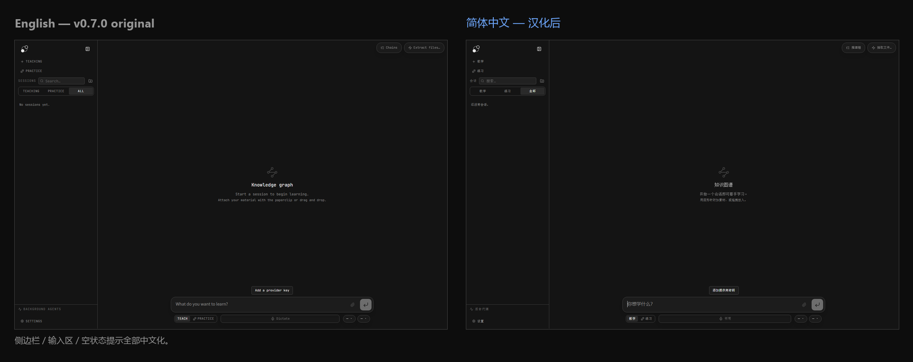
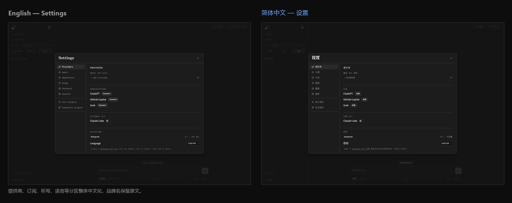
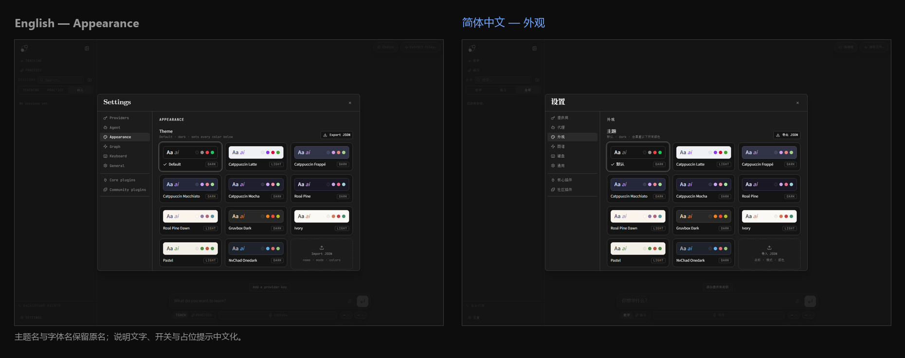
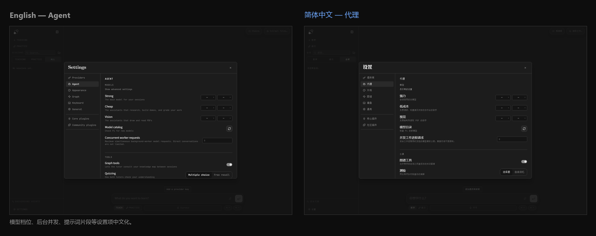

# LearnHarness 简体中文汉化补丁

> 非官方汉化。LearnHarness 由 [Amos Blomqvist](https://github.com/amosblomqvist/learnharness) 开发，AGPL-3.0 许可。
> 本仓库只包含**汉化补丁与工具**（词典、应用脚本、截图），不包含 LearnHarness 程序本体。


LearnHarness 是「有记忆的 AI 学习导师」：它会先探查你已经掌握什么，再贴着你的理解边缘教学，并把每次会话沉淀成知识图谱。
本项目把它的界面整体译成简体中文——**不动程序逻辑，只换界面文案**。

---

## 效果对比

### 主界面（左：英文原版 / 右：汉化后）



### 设置 · 提供商



### 设置 · 外观



### 设置 · 代理



---

## 覆盖范围

| 区域 | 状态 | 说明 |
|---|---|---|
| 侧边栏、搜索、会话列表、空状态 | ✅ 全中文 | 教学/练习/会话/全部/还没有会话 |
| 输入区、模式切换、听写 | ✅ 全中文 | 你想学什么？/附加文件/开始听写 |
| 设置：提供商、代理、外观、图谱、键盘、通用 | ✅ 全中文 | 888 条词条覆盖菜单、标签、开关、占位提示 |
| 设置：核心插件 / 社区插件 | ✅ 全中文 | 插件名称与描述一并翻译 |
| 知识图谱、推理链、各类按钮与提示 | ✅ 全中文 | 工具链、空状态、错误提示 |
| 品牌名 | 🔒 保留英文 | ChatGPT / Claude Code / Deepgram / Tavily / Exa … |
| 主题名与字体名 | 🔒 保留英文 | Catppuccin Mocha / Gruvbox Dark / Source Sans 3 … |
| 提示词片段文件名（设置 → 代理） | 🔒 保留英文 | `Voice`、`Accuracy` 等是英文提示词文件的标题，翻译会改变导师行为 |

术语统一：**会话 / 导师 / 学习者 / 知识图谱 / 抽取 / 推理链 / 插件 / 提供商 / 密钥 / 上下文压缩**（详见 [dict/glossary.md](dict/glossary.md)）。

---

## 快速开始

环境要求：**Node.js ≥ 18**（仅用于跑脚本）。先彻底退出 LearnHarness。

```bash
git clone https://github.com/ashtondebug/learnharness-zh.git
cd learnharness-zh

# 1) 先看会改哪些地方，不写文件
node scripts/apply-zh.mjs --dry-run

# 2) 正式汉化（自动定位安装目录，并在安装目录内建 .lh-zh-backup 备份）
node scripts/apply-zh.mjs

# 3) 退出应用 → 清缓存 → 重新打开
```

Windows 清缓存（汉化后首次启动若仍是英文，就是这步没做）：

```powershell
Get-Process LearnHarness -ErrorAction SilentlyContinue | Stop-Process -Force
Remove-Item -Recurse -Force "$env:APPDATA\LearnHarness\Cache","$env:APPDATA\LearnHarness\Code Cache" -ErrorAction SilentlyContinue
```

手动指定安装目录（非默认安装位置时）：

```bash
node scripts/apply-zh.mjs --target "D:\Apps\learnharness\resources\server\standalone"
```

### 还原英文原版

```bash
node scripts/apply-zh.mjs --restore
```

还原后同样需要清一次 Electron 缓存再启动。

---

## 为什么是「打补丁」而不是重新构建？

安装目录里只带 Next.js 的**编译产物**（`.next`），没有 tailwind/postcss/typescript，无法 `npm run build`。
但界面文案在编译产物里仍是普通字符串字面量，而且**服务端渲染 chunk 与浏览器 chunk 里各有一份**——两份必须同时替换，否则 React 水合会报警。

```mermaid
flowchart LR
  A[dict/dict.json<br/>882 条词典] --> B{apply-zh.mjs}
  B -->|整句词条| C[全局精确替换<br/>引号内完整字面量]
  B -->|风险短词| D[仅界面属性位替换<br/>label/children/placeholder…]
  C --> E[.next/server/chunks/ssr]
  C --> F[.next/static/chunks]
  D --> E
  D --> F
  E --> G[中文界面]
  F --> G
  B -.跳过.-> H[模块导出名<br/>Object.defineProperty]
  B -.跳过.-> I[对象键位置<br/>{"X": …}]
```

### 三条必须遵守的护栏

这套补丁踩过三个会导致**应用直接打不开**的坑，脚本里都做了防护：

1. **模块导出名不能翻** —— 编译产物里有 `Object.defineProperty(r,"Name",{get:()=>d.Name})` 这种再导出垫片，把 `"Name"` 换成 `"名称"` 会让 `n.Name` 变成 undefined，报 `n.Name is not a constructor`。
2. **对象键位置不能翻** —— `{"Teaching": Component}`、`map["Open"]` 这类查表键一旦翻掉，组件查不到，报 `Element type is invalid`。
3. **不能用带原型的字典查表** —— `dict["constructor"]` 会命中 `Object` 构造函数，把代码里的 `"constructor"` 替换成 `function Object() { [native code] }`。脚本用 `Object.create(null)` 规避。

风险短词清单固化在 [dict/risky-keys.json](dict/risky-keys.json)（55 个）。不确定时可用保守模式：

```bash
node scripts/apply-zh.mjs --safe   # 只替换含空格的整句，绝不碰单词
```

---

## 附带修复：首页 500（缺 shiki 依赖）

部分 0.7.0 安装包在打包时漏掉了代码高亮库的运行时依赖，表现为**打开应用首页直接 500**：

```
Cannot find package '@shikijs/core' imported from .next\node_modules\shiki-xxxx\dist\bundle-full.mjs
```

安装包自带的 `@streamdown/code/node_modules/@shikijs` 里有同版本（3.23.0）的包，直接补齐即可：

```powershell
powershell -ExecutionPolicy Bypass -File scripts/fix-shiki-deps.ps1
```

补完之后服务端和窗口才能正常加载——**这一步与汉化无关，但不做就没法用**。

---

## 目录结构

```
dict/
  dict.json          882 条英中词典（本项目的核心资产）
  risky-keys.json    55 个风险短词（只在界面属性位替换）
  glossary.md        术语表
plugins/
  zh-labels.json     4 个内置插件的名称/描述译文
scripts/
  apply-zh.mjs       汉化 / 还原 / 备份 / dry-run
  snap.mjs           无头浏览器截图（用于生成对比图）
  verify-ui.mjs      逐页截图并列出残留英文
  fix-shiki-deps.ps1 修复缺失的 shiki 依赖
docs/images/         截图与对比图
```

---

## 常见问题

**汉化后界面还是英文？**
Electron 有磁盘缓存。退出应用，删除 `%APPDATA%\LearnHarness\Cache`、`Code Cache`、`GPUCache` 后重启。

**应用自动更新了，汉化消失？**
更新会覆盖 `.next`。重新执行一次 `node scripts/apply-zh.mjs` 即可；若新版本改了措辞，没命中的词条会计入输出统计。跨版本升级后若出现页面异常，先 `--restore` 回退，再用 `--safe` 模式重试。

**`--restore` 用的是哪份备份？**
首次汉化时自动生成在安装目录的 `.lh-zh-backup/next`（约 55 MB），之后不会覆盖，始终保留最初的英文原版。

**会改动我的学习数据吗？**
不会。只改 `resources/server/standalone/.next` 下的编译产物与 `core-plugins/*/manifest.json` 的两个文本字段；`%APPDATA%\LearnHarness\data` 完全不动。

**为什么不直接把整个应用开源分发？**
LearnHarness 是 AGPL-3.0 软件，分发其副本需要连带提供完整源码并保留版权声明。本仓库选择更干净的做法：**只分发我们自己写的词典与脚本**，由使用者在本地对自己的安装打补丁。

---

## 许可与致谢

- 本项目（词典、脚本、截图）以 **AGPL-3.0** 发布，见 [LICENSE](LICENSE)。
- LearnHarness 版权归 **Amos Blomqvist** 所有，上游仓库：<https://github.com/amosblomqvist/learnharness>。
- 界面文案的原始英文文本来自 LearnHarness，译文由本项目维护；词典属于对原作品的演绎，因此沿用同一许可。
- 本项目与上游作者无隶属关系，未获其背书。若原作者有异议，请开 issue，我会立即调整。

---

<sub>English summary: an unofficial Simplified-Chinese localization patch for LearnHarness. It ships a 882-entry dictionary and a patcher that rewrites the compiled Next.js chunks (server + client in lockstep). Restore with `node scripts/apply-zh.mjs --restore`. Licensed AGPL-3.0; LearnHarness © Amos Blomqvist.</sub>
